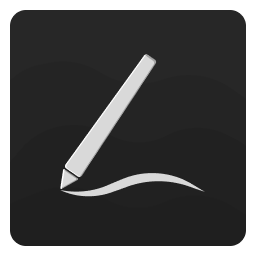

### `NextTabletDriver`

A high-performance user-mode drawing tablet driver written in Rust, designed to minimize input lag. A modern alternative to OpenTabletDriver.

<a href="https://github.com/Next-Tablet-Driver/NextTabletDriver">Website</a> ·
<a href="https://github.com/Next-Tablet-Driver/NextTabletDriver">Download</a> ·
<a href="https://github.com/Next-Tablet-Driver/NextTabletDriver">Docs</a> ·
<a href="https://github.com/Next-Tablet-Driver/NextTabletDriver">Contribute</a> ·
<a href="https://github.com/Next-Tablet-Driver/NextTabletDriver">Release Notes</a>

  

    
    
    
    
    
  

---

# Hey, I'm iSweat 👋
> Developer focused on low-level, hands-on projects. I build things I'm genuinely invested in, with an emphasis on quality over quantity.

## ⚙️ Stack & Tools
*   **Languages:** Rust, Go, Python
*   **Design & Dev:** Figma, VS Code
*   **Daily Drivers:** Discord, Notion / Notes, and AI-assisted workflows

> [!NOTE]
> **I have a strong interest in reverse engineering** I enjoy digging into how hardware and software work under the hood.
> 
> ⚡ **Current project:** NextTabletDriver Updates

---

## 👀 Current Focus
**[NextTabletDriver](https://github.com/Next-Tablet-Driver/NextTabletDriver)** is my flagship project and the one I'm most proud of.

> I maintain 83 repositories in total, most of them private. I'm gradually opening more of them up as they reach a stable, shareable state.

## 🎯 Goals for 2026
*   [ ] Learn Lua (abandoned)
*   [x] Get comfortable with Python
*   [ ] Bring **NextTabletDriver** to a polished, stable release (current)
*   [ ] Open-source more of my private projects (soon)

## 🔰 Learned This Year
*   [x] Python fundamentals

---

## 🧠 Learning Next
Expanding into more creative disciplines, such as drawing and 3D modeling, to complement my technical work.

## 💖 What I Love
Design • Drawing • Programming... I'm drawn to creative work in all its forms.

---

## 📬 How you can reach me?
The best way to reach me is on Discord: **isweatmc**

